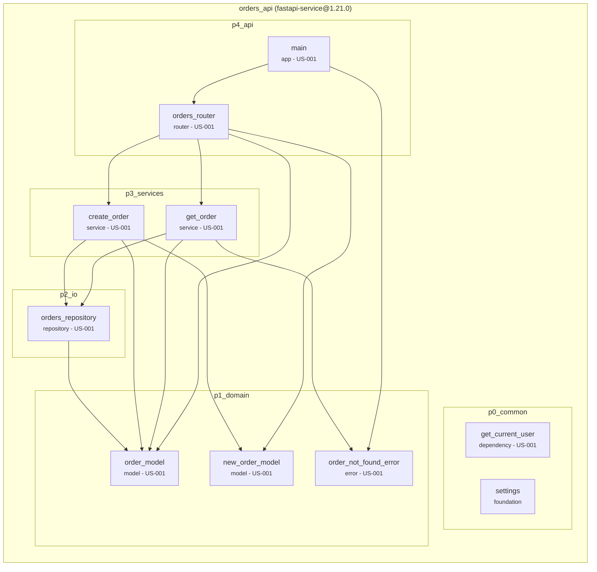

<!-- archvow spec of the project - all components, rules, hazards and checks on one page. Generated from the vows (.archvow/spec.vow, .archvow/components/), do not edit. -->

# orders_api - the project's spec

Each component's own spec (its task): `.archvow/components/<component>/spec.md`, or `archvow show <component>`.

## Architecture - orders_api

Orders

## Traceability - orders_api

What exists, where, and why. Implementation status: `archvow check` or `.archvow/status.md` (local).

| Spec | Layer | Component | Type | File | Public symbols | Invariants |
|---|---|---|---|---|---|---|
| - | p0_common | settings | foundation | `src/orders_api/p0_common/settings.py` | `Settings`, `get_settings` | - |
| US-001 | p0_common | get_current_user | dependency | `src/orders_api/p0_common/get_current_user.py` | `get_current_user` | - |
| US-001 | p1_domain | new_order_model | model | `src/orders_api/p1_domain/new_order_model.py` | `NewOrder` | - |
| US-001 | p1_domain | order_model | model | `src/orders_api/p1_domain/order_model.py` | `Order` | - |
| US-001 | p1_domain | order_not_found_error | error | `src/orders_api/p1_domain/order_not_found_error.py` | `OrderNotFoundError` | - |
| US-001 | p2_io | orders_repository | repository | `src/orders_api/p2_io/orders_repository.py` | `OrdersRepository` | - |
| US-001 | p3_services | create_order | service | `src/orders_api/p3_services/create_order.py` | `create_order` | create_order.INV1 |
| US-001 | p3_services | get_order | service | `src/orders_api/p3_services/get_order.py` | `get_order` | - |
| US-001 | p4_api | main | app | `src/orders_api/p4_api/main.py` | `create_app` | - |
| US-001 | p4_api | orders_router | router | `src/orders_api/p4_api/orders_router.py` | `router`, `post_order`, `read_order` | orders_router.INV1 |

## Project rules - orders_api

The project's own rules, in plain words (`archvow rule add`). Each component a rule applies to implements it and has a test for it.

| Rule | Applies to | Components today | What it says |
|---|---|---|---|
| - | - | - | none yet: archvow rule add <component> "Given ..., when ..., then ..." |

## Hazards - orders_api

What must never happen, and the invariant that prevents it (what is always true, so it cannot happen: Invariants, below). A critical or high hazard needs one; medium and low may have one.

| Hazard | Component | Severity | What must never happen | Prevented by |
|---|---|---|---|---|
| orders_router.H1 | orders_router | critical | A customer reads another customer's order | orders_router.INV1 |
| create_order.H1 | create_order | high | An order is saved with an amount of zero or less | create_order.INV1 |

### Not applicable

Safety questions that cannot happen here, and why.

| Component | Question | Why it cannot happen here |
|---|---|---|
| create_order | missing | No outside dependency: the repository is in memory, in the same process |
| create_order | partial | One write to one in-memory store: nothing is saved in two places |
| get_current_user | missing | Reads a request header only: it calls nothing that can be down |
| get_order | repeated | Reads only: repeating it, stopping it halfway or running it twice at once changes nothing |
| get_order | partial | Reads only: repeating it, stopping it halfway or running it twice at once changes nothing |
| get_order | concurrent | Reads only: repeating it, stopping it halfway or running it twice at once changes nothing |
| main | missing | Builds the app only: it calls nothing that can be down |
| order_model | exposed | orders hold no personal data beyond the customer id |
| order_not_found_error | exposed | Its message names nothing but the fact that no order was found |
| orders_repository | missing | In memory, in the process: no outside store to be down, one write per change, no cache or replica |
| orders_repository | partial | In memory, in the process: no outside store to be down, one write per change, no cache or replica |
| orders_repository | stale | In memory, in the process: no outside store to be down, one write per change, no cache or replica |
| orders_router | more | No route returns a list; each answer is one order |

## Invariants - orders_api

What is always true, so a hazard cannot happen (Hazards, above), and what checks it. `archvow check` fails while a coded component's invariant is not tested.

| Invariant | Component | Always true | Prevents | Tested by |
|---|---|---|---|---|
| create_order.INV1 | create_order | every saved order has an amount greater than zero | create_order.H1 (high) | a Hypothesis @given test marked @pytest.mark.invariant("create_order.INV1") |
| orders_router.INV1 | orders_router | a customer only ever reads their own orders | orders_router.H1 (critical) | a Hypothesis @given test marked @pytest.mark.invariant("orders_router.INV1") |

## Personal data - orders_api

Every column the spec classifies as personal or special (GDPR art. 9), and the components that read, change and write it. Input for the record of processing (GDPR art. 30).

| Column | Class | Declared in | Handled by | Removed or pseudonymised by | Written by |
|---|---|---|---|---|---|
| customer | personal | order_model | create_order, get_order, main, orders_repository, orders_router | - | orders_repository |

4 column(s) classified as not personal.

### Purpose, legal basis, retention, location

| Component | Question | Answer |
|---|---|---|
| orders_repository | P1 Retention: how long is the personal data it writes kept, how is it deleted then, and how is one person's data erased on request (art. 17) - e.g. 5 years, then deleted; one person's rows deleted by id? | In memory: gone when the service stops; nothing kept, nothing to erase on request |
| orders_repository | P2 Location: in which country or region is it stored? Outside the EU/EEA, which safeguard applies (adequacy decision, standard contractual clauses - art. 46) - e.g. France, cloud region eu-west-3? | The service's own memory, in the EU |
| orders_router | P1 Purpose: why does it process personal data (the columns of its spec card), and for whom - e.g. to bill customers for their orders, for the finance team? | Take and show the orders of each customer, for that customer only |
| orders_router | P2 Legal basis (GDPR art. 6): consent, contract, legal obligation, vital interests, public task or legitimate interests - and where is it recorded - e.g. contract, in the record of processing? | Contract: the customer's orders (terms of sale) |

## Briefs - orders_api

Where the spec comes from: each component, question and rule drawn from a brief (`--from`). `archvow check` warns when a section changes (ARCH039); after review, `archvow brief accept <brief>` records its new text.

| Brief | Drawn from it | Text recorded |
|---|---|---|
| `briefs/orders.md#reading-an-order` | orders_router example US-001-another-customers-order | `a70f6aed477a` |

## Checks

What `archvow check` verifies on every component's code, family by family (the families the project turned on). Severity shown is the effective one (template defaults + the `rules` overrides of .archvow/spec.vow). Silence a single line only with a reason: `# archvow: ignore[CODE] -- why`.

### ARCH - Architecture: structure, layers, tests, hazards, AI policy

| Code | Severity | Rule |
|---|---|---|
| ARCH001 | error | Module not declared in the spec |
| ARCH002 | error | Public symbol not declared in the spec |
| ARCH003 | error | Declared symbol not implemented, or still a placeholder (reported with --complete) |
| ARCH004 | error | Signature/annotation differs from the spec |
| ARCH005 | error | Illegal dependency between layers |
| ARCH006 | error | Undeclared dependency between components (missing in `uses`) |
| ARCH007 | error | Import forbidden in this layer |
| ARCH008 | error | Declared module file not created (reported with --complete) |
| ARCH009 | error | Invalid entry in a vow |
| ARCH010 | error | File outside any layer (neither a layer folder nor mapped in `layer_paths`) |
| ARCH011 | error | Suppression without a justification |
| ARCH012 | warning | Project template version differs from installed template |
| ARCH013 | error | File cannot be parsed |
| ARCH014 | error | Entry of a vow differs from what its template generates (hand-edited?) |
| ARCH015 | error | Python file outside the architecture (no container, not an allowed path) |
| ARCH016 | error | Test file does not follow the test layout |
| ARCH017 | error | Implemented component without its test |
| ARCH018 | error | Component file without a correct file header |
| ARCH019 | warning | Component without the data contract its type works on (a reader without its schema) |
| ARCH020 | error | Guard weakened compared to the base branch |
| ARCH040 | error | Configuration of an AI assistant not approved for this repository |
| ARCH041 | error | Review by an AI tool not approved as a reviewer |
| ARCH042 | error | Review by the AI tool that wrote the code (self-review) |
| ARCH030 | error | Critical/high hazard that no invariant prevents |
| ARCH031 | error | An invariant of an implemented component is not tested yet |
| ARCH032 | error | An invariant's test is not of the kind it requires |
| ARCH033 | error | Implemented while a decision is still to make |
| ARCH034 | error | Implemented on an assumption nobody reviewed yet |
| ARCH035 | warning | Safety question of a component not answered (no hazard, no dismissal) |
| ARCH036 | error | Invalid hazard, dismissal, invariant or project rule entry |
| ARCH037 | error | Invariant tested too weakly for the hazard's severity |
| ARCH038 | warning | A decision or rule of an implemented component has no marked test |
| ARCH043 | warning | What the AI proposed or added (a decision, a component, a question, a hazard, a rule) is not reviewed by a person yet (an error at the release gate in mode guided) |
| ARCH044 | warning | A component's task is too long for one AI session (over max_tokens) |
| ARCH045 | warning | A test marked as evidence checks nothing (an error in mode strict and with --complete) |
| ARCH046 | error | A marked test did not run and pass in the test report (check --test-report) |
| ARCH050 | error | A file in .archvow/ that archvow does not write (nobody owns it in CODEOWNERS) |
| ARCH051 | error | An AI agent runs archvow outside a sandbox (it can write outside the project) |
| ARCH052 | error | An AI agent runs archvow in YOLO mode (it acts without asking anyone) |
| ARCH054 | error | An AI agent runs a command only a person runs (it decides or changes the spec) |
| ARCH053 | warning | Code an AI agent wrote, with no proof it ran protected (an error when it ran blocked, or in mode strict) |
| ARCH039 | warning | A brief changed after the spec was drawn from it |
| ARCH055 | error | A business example's files differ from the ones a person recorded |
| ARCH056 | warning | A business example has no marked test (an error in mode strict and with --complete) |
| ARCH057 | warning | An item recorded before its component changed is not reviewed yet (an error with --complete) |
| ARCH058 | error | The project is over its limit of components or lines of code (a warning from 90 %) |
| ARCH021 | warning | New suppression compared to the base branch |
| ARCH022 | error | Change too big for one merge request (files or lines over the budget) |
| ARCH023 | error | Third-party package imported without approval |
| ARCH024 | warning | Package in requirements.txt or pyproject.toml without approval (an error in mode strict) |

### STYLE - Size, scripts and comments

| Code | Severity | Rule |
|---|---|---|
| STY001 | warning | File longer than allowed |
| STY002 | warning | Function longer than allowed |
| STY003 | warning | Shell script longer than allowed (move the logic into Python) |
| STY004 | warning | Too many comment lines for the code (say it in names and docstrings) |

PEP 8 and the Python style rules are enforced by ruff (ruff.toml).

### FASTAPI - FastAPI: async, HTTP errors, app and routes

| Code | Severity | Rule |
|---|---|---|
| FAPI001 | error | Blocking call inside an async function (it stops every other request) |
| FAPI002 | error | HTTPException outside the HTTP layers (raise a domain error instead) |
| FAPI003 | error | FastAPI app created outside an app component |
| FAPI004 | error | on_event startup/shutdown handler (use the lifespan of the app) |
| FAPI005 | warning | Route without a response model or return type |

### GDPR - Personal data (GDPR / RGPD): every column classified, then the code checked

| Code | Severity | Rule |
|---|---|---|
| GDPR001 | error | Column not classified in the spec (personal, special or none) |
| GDPR002 | error | Personal data processed without a decided purpose and legal basis |
| GDPR003 | error | Personal data written without a decided retention and erasure |
| GDPR004 | error | Personal data printed, shown or logged |
| GDPR005 | error | Special-category data written without a tested pseudonymisation or encryption |
| GDPR006 | error | Files partitioned or bucketed by a personal column (values end up in paths) |
| GDPR007 | error | Personal data in a URL (path or query parameter: it ends up in access logs) |
| GDPR008 | error | Personal data stored without a decided location and transfer safeguard |
| GDPR009 | warning | Classified column not found in the code |

### TST - Test data: no real data in tests

| Code | Severity | Rule |
|---|---|---|
| TST001 | error | A test reads data from outside tests/ (database, cloud storage, absolute path) |
| TST002 | error | Real-looking personal identifier in test data |
| TST003 | error | Binary or too large data file in tests/ (a real extract?) |
