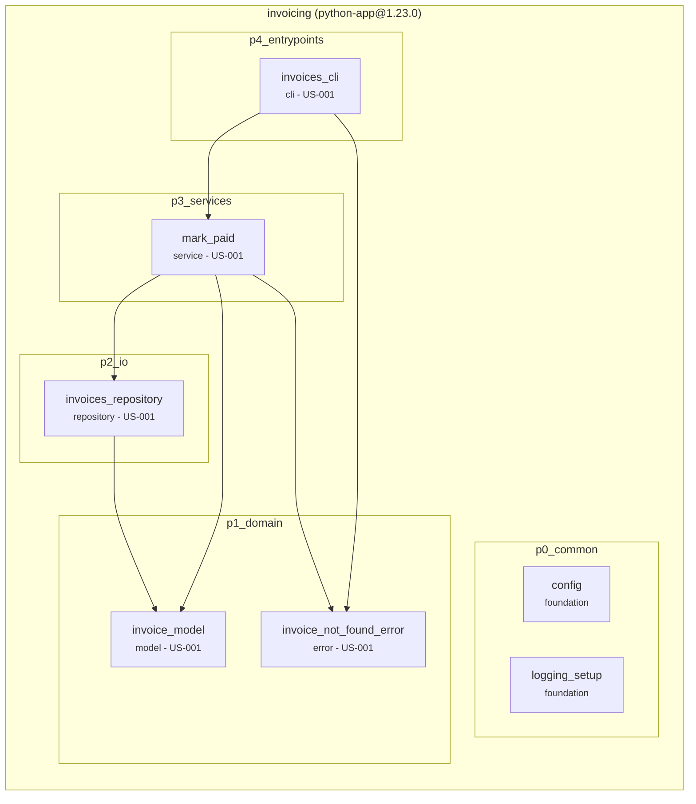

<!-- archvow spec of the project - all components, rules, hazards and checks on one page. Generated from the vows (.archvow/spec.vow, .archvow/components/), do not edit. -->

# invoicing - the project's spec

Each component's own spec (its task): `.archvow/components/<component>/spec.md`, or `archvow show <component>`.

## Architecture - invoicing

Marks invoices paid, from the command line

## Traceability - invoicing

What exists, where, and why. Implementation status: `archvow check` or `.archvow/status.md` (local).

| Spec | Layer | Component | Type | File | Public symbols | Invariants |
|---|---|---|---|---|---|---|
| - | p0_common | config | foundation | `src/invoicing/p0_common/config.py` | `Config`, `load_config` | - |
| - | p0_common | logging_setup | foundation | `src/invoicing/p0_common/logging_setup.py` | `setup_logging` | - |
| US-001 | p1_domain | invoice_model | model | `src/invoicing/p1_domain/invoice_model.py` | `Invoice` | invoice_model.INV1 |
| US-001 | p1_domain | invoice_not_found_error | error | `src/invoicing/p1_domain/invoice_not_found_error.py` | `InvoiceNotFoundError` | - |
| US-001 | p2_io | invoices_repository | repository | `src/invoicing/p2_io/invoices_repository.py` | `InvoicesRepository` | invoices_repository.INV1 |
| US-001 | p3_services | mark_paid | service | `src/invoicing/p3_services/mark_paid.py` | `mark_paid` | mark_paid.INV1 |
| US-001 | p4_entrypoints | invoices_cli | cli | `src/invoicing/p4_entrypoints/invoices_cli.py` | `main` | - |

## Project rules - invoicing

The project's own rules, in plain words (`archvow rule add`). Each component a rule applies to implements it and has a test for it.

| Rule | Applies to | Components today | What it says |
|---|---|---|---|
| - | - | - | none yet: archvow rule add <component> "Given ..., when ..., then ..." |

## Hazards - invoicing

What must never happen, and the invariant that prevents it (what is always true, so it cannot happen: Invariants, below). A critical or high hazard needs one; medium and low may have one.

| Hazard | Component | Severity | What must never happen | Prevented by |
|---|---|---|---|---|
| invoice_model.H1 | invoice_model | high | An invoice with a negative amount is accepted | invoice_model.INV1 |
| invoices_repository.H1 | invoices_repository | high | An invoice file is half written | invoices_repository.INV1 |
| mark_paid.H1 | mark_paid | high | Paying twice changes the invoice twice | mark_paid.INV1 |

### Not applicable

Safety questions that cannot happen here, and why.

| Component | Question | Why it cannot happen here |
|---|---|---|
| invoice_model | exposed | Invoices hold no secret; the customer name is printed only to the person who runs the command |
| invoice_not_found_error | exposed | Its message is fixed and names only the invoice number the user typed |
| invoices_cli | wrong | argparse refuses bad arguments with exit code 2 (decision 1) |
| invoices_cli | exposed | It prints only the invoice the user asked for, to that user |
| invoices_repository | missing | A missing file is reported as None, the service raises InvoiceNotFoundError (decision 2) |
| invoices_repository | more | It reads one invoice at a time, by number |
| invoices_repository | stale | Nothing is cached: every call reads the file |
| invoices_repository | concurrent | Concurrent writes give the same paid invoice (decision 4) |
| invoices_repository | exposed | Files stay in the data folder; nothing is logged |
| mark_paid | missing | InvoiceNotFoundError (decision 2) |
| mark_paid | partial | One save, written completely or not at all (invoices_repository.INV1) |
| mark_paid | concurrent | Two runs write the same paid invoice (decision 3) |
| mark_paid | exposed | Nothing is logged or printed here |

## Invariants - invoicing

What is always true, so a hazard cannot happen (Hazards, above), and what checks it. `archvow check` fails while a coded component's invariant is not tested.

| Invariant | Component | Always true | Prevents | Tested by |
|---|---|---|---|---|
| invoice_model.INV1 | invoice_model | every invoice has an amount of zero or more | invoice_model.H1 (high) | a test marked @pytest.mark.invariant("invoice_model.INV1") |
| invoices_repository.INV1 | invoices_repository | an invoice file is complete or absent | invoices_repository.H1 (high) | a test marked @pytest.mark.invariant("invoices_repository.INV1") |
| mark_paid.INV1 | mark_paid | marking an invoice paid twice gives the same invoice as once | mark_paid.H1 (high) | a test marked @pytest.mark.invariant("mark_paid.INV1") |

## Personal data - invoicing

Every column the spec classifies as personal or special (GDPR art. 9), and the components that read, change and write it. Input for the record of processing (GDPR art. 30).

| Column | Class | Declared in | Handled by | Removed or pseudonymised by | Written by |
|---|---|---|---|---|---|
| customer | personal | invoice_model | invoices_cli, invoices_repository, mark_paid | - | invoices_repository |

3 column(s) classified as not personal.

### Purpose, legal basis, retention, location

| Component | Question | Answer |
|---|---|---|
| invoices_repository | P1 Retention: how long is the personal data it writes kept, how is it deleted then, and how is one person's data erased on request (art. 17) - e.g. 5 years, then deleted; one person's records deleted by id? | 10 years (accounting law), then the file is deleted; one person's invoices are kept until then (legal obligation) |
| invoices_repository | P2 Location: in which country or region is it stored? Outside the EU/EEA, which safeguard applies (adequacy decision, standard contractual clauses - art. 46) - e.g. France, cloud region eu-west-3? | The company's file server, in France |
| mark_paid | P1 Purpose: why does it process personal data (the fields of its spec card), and for whom - e.g. to send invoices to customers, for the finance team? | To record which customers paid their invoices, for the finance team |
| mark_paid | P2 Legal basis (GDPR art. 6): consent, contract, legal obligation, vital interests, public task or legitimate interests - and where is it recorded - e.g. contract, in the record of processing? | Contract: the customer's purchase |

## Briefs - invoicing

Where the spec comes from: each component, question and rule drawn from a brief (`--from`). `archvow check` warns when a section changes (ARCH039); after review, `archvow brief accept <brief>` records its new text.

| Brief | Drawn from it | Text recorded |
|---|---|---|
| `briefs/invoices.md#paying-a-sent-invoice` | invoices_cli example US-001-pay-a-sent-invoice | `9652dc816ffb` |

## Checks

What `archvow check` verifies on every component's code, family by family (the families the project turned on). Severity shown is the effective one (template defaults + the `rules` overrides of .archvow/spec.vow). Silence a single line only with a reason: `# archvow: ignore[CODE] -- why`.

### ARCH - Architecture: structure, layers, tests, hazards, AI policy

| Code | Severity | Rule |
|---|---|---|
| ARCH001 | error | Module not declared in the spec |
| ARCH002 | error | Public symbol not declared in the spec |
| ARCH003 | error | Declared symbol not implemented, or still a placeholder (reported with --complete) |
| ARCH004 | error | Signature/annotation differs from the spec |
| ARCH005 | error | Illegal dependency between layers |
| ARCH006 | error | Undeclared dependency between components (missing in `uses`) |
| ARCH007 | error | Import forbidden in this layer |
| ARCH008 | error | Declared module file not created (reported with --complete) |
| ARCH009 | error | Invalid entry in a vow |
| ARCH010 | error | File outside any layer (neither a layer folder nor mapped in `layer_paths`) |
| ARCH011 | error | Suppression without a justification |
| ARCH012 | warning | Project template version differs from installed template |
| ARCH013 | error | File cannot be parsed |
| ARCH014 | error | Entry of a vow differs from what its template generates (hand-edited?) |
| ARCH015 | error | Python file outside the architecture (no container, not an allowed path) |
| ARCH016 | error | Test file does not follow the test layout |
| ARCH017 | error | Implemented component without its test |
| ARCH018 | error | Component file without a correct file header |
| ARCH019 | warning | Component without the data contract its type works on (a reader without its schema) |
| ARCH020 | error | Guard weakened compared to the base branch |
| ARCH040 | error | Configuration of an AI assistant not approved for this repository |
| ARCH041 | error | Review by an AI tool not approved as a reviewer |
| ARCH042 | error | Review by the AI tool that wrote the code (self-review) |
| ARCH030 | error | Critical/high hazard that no invariant prevents |
| ARCH031 | error | An invariant of an implemented component is not tested yet |
| ARCH032 | error | An invariant's test is not of the kind it requires |
| ARCH033 | error | Implemented while a decision is still to make |
| ARCH034 | error | Implemented on an assumption nobody reviewed yet |
| ARCH035 | warning | Safety question of a component not answered (no hazard, no dismissal) |
| ARCH036 | error | Invalid hazard, dismissal, invariant or project rule entry |
| ARCH037 | error | Invariant tested too weakly for the hazard's severity |
| ARCH038 | warning | A decision or rule of an implemented component has no marked test |
| ARCH043 | warning | What the AI proposed or added (a decision, a component, a question, a hazard, a rule) is not reviewed by a person yet (an error at the release gate in mode guided) |
| ARCH044 | warning | A component's task is too long for one AI session (over max_tokens) |
| ARCH045 | warning | A test marked as evidence checks nothing (an error in mode strict and with --complete) |
| ARCH046 | error | A marked test did not run and pass in the test report (check --test-report) |
| ARCH050 | error | A file in .archvow/ that archvow does not write (nobody owns it in CODEOWNERS) |
| ARCH051 | error | An AI agent runs archvow outside a sandbox (it can write outside the project) |
| ARCH052 | error | An AI agent runs archvow in YOLO mode (it acts without asking anyone) |
| ARCH054 | error | An AI agent runs a command only a person runs (it decides or changes the spec) |
| ARCH053 | warning | Code an AI agent wrote, with no proof it ran protected (an error when it ran blocked, or in mode strict) |
| ARCH039 | warning | A brief changed after the spec was drawn from it |
| ARCH055 | error | A business example's files differ from the ones a person recorded |
| ARCH056 | warning | A business example has no marked test (an error in mode strict and with --complete) |
| ARCH057 | warning | An item recorded before its component changed is not reviewed yet (an error with --complete) |
| ARCH058 | error | The project is over its limit of components or lines of code (a warning from 90 %) |
| ARCH059 | error | Logging configured outside the logging_setup foundation (one place configures it) |
| ARCH021 | warning | New suppression compared to the base branch |
| ARCH022 | error | Change too big for one merge request (files or lines over the budget) |
| ARCH023 | error | Third-party package imported without approval |
| ARCH024 | warning | Package in requirements.txt or pyproject.toml without approval (an error in mode strict) |

### STYLE - Size, scripts and comments

| Code | Severity | Rule |
|---|---|---|
| STY001 | warning | File longer than allowed |
| STY002 | warning | Function longer than allowed |
| STY003 | warning | Shell script longer than allowed (move the logic into Python) |
| STY004 | warning | Too many comment lines for the code (say it in names and docstrings) |

PEP 8 and the Python style rules are enforced by ruff (ruff.toml).

### GDPR - Personal data (GDPR / RGPD): every column classified, then the code checked

| Code | Severity | Rule |
|---|---|---|
| GDPR001 | error | Column not classified in the spec (personal, special or none) |
| GDPR002 | error | Personal data processed without a decided purpose and legal basis |
| GDPR003 | error | Personal data written without a decided retention and erasure |
| GDPR004 | error | Personal data printed, shown or logged |
| GDPR005 | error | Special-category data written without a tested pseudonymisation or encryption |
| GDPR006 | error | Files partitioned or bucketed by a personal column (values end up in paths) |
| GDPR007 | error | Personal data in a URL (path or query parameter: it ends up in access logs) |
| GDPR008 | error | Personal data stored without a decided location and transfer safeguard |
| GDPR009 | warning | Classified column not found in the code |

### TST - Test data: no real data in tests

| Code | Severity | Rule |
|---|---|---|
| TST001 | error | A test reads data from outside tests/ (database, cloud storage, absolute path) |
| TST002 | error | Real-looking personal identifier in test data |
| TST003 | error | Binary or too large data file in tests/ (a real extract?) |
