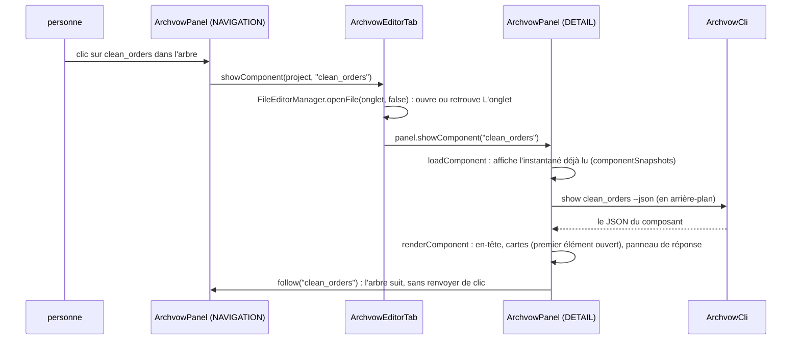
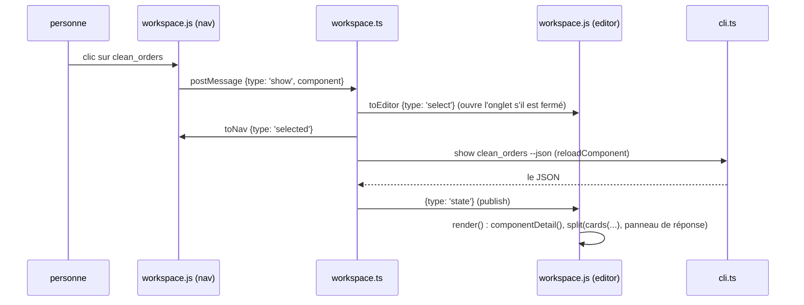

# 1. Guide de lecture

> 🇬🇧 [English version](/en/01-reading-guide) · Version française

## Préparer une copie de travail

```bash
git clone <dépôt archvow-plugin> && cd archvow-plugin
python3 -m pip install archvow==2.1.0        # la CLI avec laquelle les plugins sont testés (archvow version)

# IntelliJ : un JDK 21 (celui d'IntelliJ convient)
export JAVA_HOME="/Applications/IntelliJ IDEA.app/Contents/jbr/Contents/Home"
(cd intellij && ./gradlew check)              # coreTest + workspaceTest, sans IDE
(cd intellij && ./gradlew runIde)             # un IntelliJ de bac à sable avec le plugin

# VS Code : Node 20 ou plus
(cd vscode && npm ci && npm test)             # compile + 55 tests
# puis ouvrir vscode/ dans VS Code et F5 : une fenêtre « Extension Development Host »

./build.sh                                    # les deux, après leurs tests -> dist/
```

`./gradlew` télécharge la plateforme IntelliJ (2024.3.5) depuis les dépôts JetBrains la première fois.
Sans accès à ces dépôts, la page [Les tests](/13-tests) explique comment compiler et tester le code
contre des doublures des classes de la plateforme.

## Ce qu'il faut connaître avant de lire

| Sujet | Où les plugins l'utilisent | À savoir |
|---|---|---|
| Swing | tout `org.archvow.idea` | aucun framework d'interface en plus : `JPanel`, `CardLayout`, `JList` avec un rendu maison, `JEditorPane` en HTML 3.2 |
| La plateforme IntelliJ | `plugin.xml`, `ArchvowToolWindowFactory`, `ArchvowEditorProvider`, `org.archvow.vow` | une fenêtre d'outils, un éditeur de fichier pour l'onglet, un langage (lexer, parseur, annotateur) |
| L'API VS Code | `vscode/src/extension.ts`, `vscode/src/workspace.ts`, `vscode/src/vowLanguage.ts` | une *webview view* (barre latérale), un *webview panel* (l'onglet), des fournisseurs de langage |
| La page web | `vscode/media/workspace.js`, `vscode/media/workspace.css` | JavaScript simple, sans framework, rien chargé de l'extérieur ; la page n'exécute rien, elle demande |
| La CLI archvow | page [Lancer archvow](/05-running-archvow) | toujours `archvow <commande> --json` lu sur stdout ; stderr à part |
| Le format .vow | page [Le langage .vow](/10-vow-language) | deux espaces par niveau, une ligne `clé valeur`, des blocs ; aucune liste de mots-clés |

## Suivre un clic dans le code

Le chemin le plus rapide : suivre une fois le clic sur un composant de l'arbre, les fichiers ouverts.

**IntelliJ** (`ArchvowPanel` dans ses deux rôles) :



**VS Code** (la même page web dans deux rôles, l'extension entre elles) :



Faites ensuite de même pour **Enregistrer la réponse** (page [Un composant](/08-component)) et pour un
formulaire de commande (page [Les commandes](/09-commands)). Après ces trois-là, le reste est une
variante.

## Où commencer dans un gros fichier

`ArchvowPanel.java` fait 4 000 lignes (le découper est dans `docs/analyse-intellij.md`). Il se lit
par sections, dans cet ordre : le constructeur (les deux rôles), `buildHeader`, `overviewPanel`,
`componentPanel` (les vues d'un composant), `renderComponent`, puis les actions (`submitInlineDecision`,
`openCommand`, `executeDirect`). `vscode/media/workspace.js` suit le même ordre : `page()`,
`overviewTab()`, `componentDetail()`, les vues (`decisionsView`...), puis `actions`.
