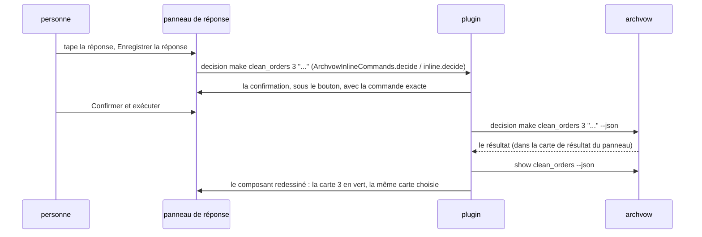

# 8. Un composant

> 🇬🇧 [English version](/en/08-component) · Version française

C'est l'écran où l'on passe le plus de temps : un composant dans l'onglet, ses éléments ouverts, et
la réponse à côté. Tout ce qu'il montre vient de `archvow show <composant> --json` (et de son entrée
dans `show --json` pour le module et le ticket).

## La disposition

```
┌───────────────────────────────────────────────────────────────────────────┐
│ ← sales_reader (Retour, s'il y a lieu)    ARCHVOW · COMPOSANT             │
│ clean_sales  3 éléments ouverts                                            │  en-tête, toute la largeur
│ transformation · p1_domain · module ... · ticket FATTRIB-12 · verified     │
│ Garder les lignes où montant > 0 ...                                       │
│ Utilise : sales_schema · Utilisé par : revenue_writer    Exemples : ✓ ...  │
│ [Clarifier] Ouvrir la spec  Ouvrir le code  Modifier la spec  ...          │  actions
│ (Décisions · 1) (Questions) (Sécurité ✓) (Hypothèses) (Règles) (Tâches) ...  │  vues
├──────────────────────────────────┬────────────────────────────────────────┤
│ 1 · Quelles lignes garde-t-elle… │ RÉPONDRE À LA DÉCISION 3               │
│     montant > 0                  │ En-tête manquant : déduire ou échouer ? │
│     kaneusb@... · 2026-10-25     │ ┌────────────────────────────────────┐ │
│ 3 · En-tête manquant…            │ │ (champ, police à chasse fixe)      │ │
│     ● Ouvert                     │ └────────────────────────────────────┘ │
│                                  │ Proposer  Annuler modif. [Enregistrer] │
└──────────────────────────────────┴────────────────────────────────────────┘
       les cartes                          le panneau de réponse
```

**L'en-tête** : le nom et le nombre d'éléments ouverts (le même que la barre latérale), puis *type ·
couche · module · ticket · état*, **une barre d'avancement** (décisions prises, sûreté traitée, tâches
faites, exemples testés - chacune seulement s'il y a quelque chose à compter -, verte quand c'est
complet, ambre sinon, les nombres dans l'infobulle : `ArchvowProgress`, `progress()` et
`progressBar()`), la description, **Tiré de** la brief d'où il vient (`source` de show ; un lien qui
ouvre la brief à son titre : `ArchvowBriefs.drawnFromHtml`, `drawnFrom()`), *Utilise · Utilisé par* (chaque nom ouvre ce
composant : ce qu'un changement peut casser, `ArchvowLinks`, `links()`) et les exemples métier (✓ testé
et inchangé, ✖ avec la raison, ARCH055/ARCH056). IntelliJ : `buildComponentHtml` dans le panneau
`componentDetails` ; VS Code : `componentDetail()`, `openBadge()`, `meta()`.

**Les actions** : Clarifier (va au premier élément ouvert : décision, puis question, puis question de
sûreté ; `guidedNext`, `chooseNext()`), Ouvrir la spec, Ouvrir le code (le fichier du `module`),
Modifier la spec, Instruction IA (`archvow prompt <composant>`), + Question, + Règle, + Composant.

**Les vues** : Décisions, Questions, Sécurité, Hypothèses, Règles, Tâches, Full vow, Autres / Projet.
Chaque bouton dit `· n` éléments en attente, ou ✓ quand tout est traité (`refreshViewStatus`,
`viewCounts()`). Sous les vues, une ligne explique pourquoi le total du composant peut dépasser la vue
(« 9 en attente · 0 dans Données et tâches · 4 dans Autres / Projet »).

## Les cartes et le panneau de réponse

Pour Décisions, Questions, Sécurité et Hypothèses, la vue est coupée en deux
(IntelliJ : `ArchvowSplitView` ; VS Code : `split()` et la grille `.split`) :

- **à gauche, les éléments en cartes** (`ArchvowItemCards`, `cards()`) : « 3 · la question » sur une
  ligne, puis la réponse enregistrée en vert avec qui et quand, ou « ● Ouvert » en orange ; une ligne
  chacune, coupée avec « … », le texte entier en infobulle et à droite ;
- **à droite, le panneau de réponse** de la carte choisie : son titre (« RÉPONDRE À LA DÉCISION 3 »,
  « DÉCISION 1 · TRAITÉE »), la question entière, la proposition de l'IA ou la suggestion, le champ, les
  autres actions à gauche, **Annuler les modifications / Enregistrer la réponse** à droite, puis la
  confirmation. « Annuler les modifications » (« Annuler » jusqu'en 0.12, dont le rôle n'était pas
  évident) ne s'active que quand le champ diffère du texte enregistré, et ne fait que le remettre : rien
  n'est enregistré ni supprimé (`cancelButton`, `recorded` ; VS Code : `answerEditor`, `undoTip`).
- Moins de 680 px (IntelliJ) ou 760 px (VS Code) : le panneau passe sous les cartes.
- Une vue sans élément affiche « Rien à afficher. », sans panneau de réponse.

**À l'ouverture d'un composant, chaque vue est sur son premier élément ouvert** (sinon le premier) :
le panneau de réponse est prêt. Le même composant redessiné (après une réponse, une relecture) garde la
carte choisie. IntelliJ : `fill()` et `renderedComponent` dans `renderComponent`,
`ArchvowItemCards.firstOpen` ; VS Code : `current()` (la carte choisie, sinon la première ouverte) et
`selectComponent()`, qui remet les choix à zéro quand le composant change.

| Vue | Champ | Actions | Commande lancée |
|---|---|---|---|
| Décisions | la réponse ou la proposition | Enregistrer la réponse, Proposer, Accepter la proposition, Utiliser la suggestion (seulement celles qui s'appliquent) | `decision make`, `decision propose`, `decision accept` |
| Questions | la réponse | Enregistrer la réponse | `decision make <c> <clé>` |
| Sécurité | le hazard, ou pourquoi il ne s'applique pas ; la gravité ; ou l'invariant requis | Déclarer un hazard, Non applicable, Utiliser le hazard (et l'invariant) proposé ; sur un hazard enregistré : Modifier, Supprimer ; Ajouter l'invariant (sur place), Ajouter un invariant…, Supprimer un invariant… | `hazard add`, `hazard dismiss`, `hazard remove` (+ `hazard add` pour Modifier), `invariant add` ; formulaires `invariant add`, `invariant remove` |
| Hypothèses | - | Accepter, Rejeter (formulaires), + Hypothèse | `assumption accept`, `assumption reject`, `assumption add` |

Un seul champ, trois usages (0.13.1) : déclarer le hazard d'une question ouverte ; modifier un hazard
enregistré (Modifier : le champ reprend son texte et sa gravité, l'enregistrement fait `hazard remove`
puis `hazard add`, confirmés une fois - seulement tant qu'aucun invariant ne le protège, archvow 1.18
n'ayant pas de `hazard edit`) ; écrire l'invariant qu'un hazard élevé ou critique attend (ARCH030), ici
même, rempli avec la suggestion du template - archvow ne la donne que tant que la question est ouverte,
les deux plugins la gardent donc (`rememberedInvariants`, `ui.suggested`). « Ajouter l'invariant requis »
des listes En attente ouvre ce champ, plus le formulaire. Une question traitée et protégée ne montre que
ses hazards, ses invariants et les suppressions. Son état suit les règles d'archvow :
`ArchvowSafetyState`, l'objet `safety` de `vscode/src/workItems.ts`. IntelliJ range les boutons dans un
`ArchvowWrapLayout` (un `FlowLayout` qui demande la hauteur de chaque ligne : « Supprimer un hazard… »
sortait du panneau).

« hazard » et « invariant » sont des mots-clés : le français les garde (« Déclarer un hazard »).

## Enregistrer une réponse, de bout en bout



IntelliJ : `submitInlineDecision` -> `requestConfirmation` (un `ArchvowConfirmPanel` dans le
`decisionConfirmSlot`) -> `runInlineComponentAction`. VS Code : la page envoie `inline`,
`ArchvowProject.inlineAction` construit la commande, `confirm` envoie un jeton, la page répond
`confirmed`, puis `execute` et `reloadComponent`. Changer de carte, de vue ou de composant annule une
confirmation laissée ouverte : on ne confirme jamais une action préparée pour autre chose.

## Les autres vues

| Vue | Ce qu'elle montre | Actions |
|---|---|---|
| Règles | les règles qui s'appliquent au composant (R1, R2...) et leur portée | Ajouter, Modifier, Supprimer une règle (formulaires) |
| Tâches | les colonnes à classer et les tâches de la fiche ; données personnelles | Classer la colonne (`column set`), les instructions d'une tâche (`prompt <c> --task n`, `ArchvowTaskPrompt`, `promptCommand()`) |
| Full vow | le `spec.vow` du composant, coloré, en lecture seule | Ouvrir la spec |
| Autres / Projet | les contrôles et éléments de tout le projet, ou sans composant prouvé | l'action de chaque élément ; une correction n'est tirée d'un message que si elle est documentée (`ArchvowIssueAction`, `issueFix()`), jamais exécutée telle quelle |
