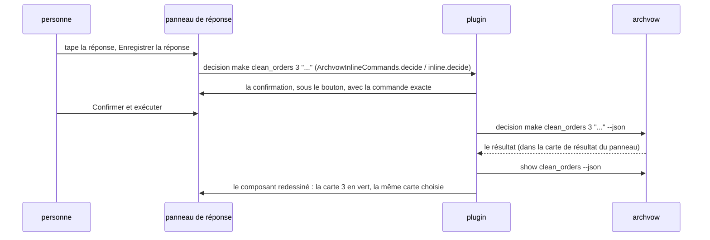

# 8. Un composant

> 🇬🇧 [English version](/en/08-component) · Version française

C'est l'écran où l'on passe le plus de temps : un composant dans l'onglet, ses éléments ouverts, et
la réponse à côté. Tout ce qu'il montre vient de `archvow show <composant> --json` (et de son entrée
dans `show --json` pour le module et le ticket).

## La disposition

```
┌───────────────────────────────────────────────────────────────────────────┐
│ ← sales_reader (Retour, s'il y a lieu)    ARCHVOW · COMPOSANT             │
│ clean_sales  3 éléments ouverts                                            │  en-tête, toute la largeur
│ transformation · p1_domain · module ... · ticket FATTRIB-12 · verified     │
│ Garder les lignes où montant > 0 ...                                       │
│ Utilise : sales_schema · Utilisé par : revenue_writer    Exemples : ✓ ...  │
│ [Clarifier] Ouvrir le code  Modifier la spec  ...                          │  actions
│ (Décisions · 1) (Questions) (Sécurité ✓) (Hypothèses) (Règles) (Exemples) ... │  vues
├──────────────────────────────────┬────────────────────────────────────────┤
│ 1 · Quelles lignes garde-t-elle… │ RÉPONDRE À LA DÉCISION 3               │
│     montant > 0                  │ En-tête manquant : déduire ou échouer ? │
│     kaneusb@... · 2026-10-25     │ ┌────────────────────────────────────┐ │
│ 3 · En-tête manquant…            │ │ (champ, police à chasse fixe)      │ │
│     ● Ouvert                     │ └────────────────────────────────────┘ │
│                                  │ Proposer  Annuler modif. [Enregistrer] │
└──────────────────────────────────┴────────────────────────────────────────┘
       les cartes                          le panneau de réponse
```

**L'en-tête** : le nom et le nombre d'éléments ouverts (le même que la barre latérale), puis *type ·
couche · module · ticket · état*, **une barre d'avancement** (décisions prises, sûreté traitée, tâches
faites, exemples réussis - chacune seulement s'il y a quelque chose à compter -, verte quand c'est
complet, ambre sinon, les nombres dans l'infobulle : `ArchvowProgress`, `progress()` et
`progressBar()`), la description, **Tiré de** la brief d'où il vient (`source` de show ; un lien qui
ouvre la brief à son titre : `ArchvowBriefs.drawnFromHtml`, `drawnFrom()`), *Utilise · Utilisé par* (chaque nom ouvre ce
composant : ce qu'un changement peut casser, `ArchvowLinks`, `links()`) et les exemples métier (✓ réussi,
✖ en échec ou modifié, ○ sans test : ce que dit le dernier passage du test, ARCH055/ARCH056). IntelliJ : `buildComponentHtml` dans le panneau
`componentDetails` ; VS Code : `componentDetail()`, `openBadge()`, `meta()`.

**Les actions** : Clarifier (va au premier élément ouvert : décision, puis question, puis question de
sûreté ; `guidedNext`, `chooseNext()`), Ouvrir le code (le fichier du `module`),
Modifier la spec, Instruction IA (`archvow prompt <composant>`), + Question, + Règle, + Composant ;
Accepter… pour un composant créé par l'IA (archvow 1.19, modes guided et free : son vow dit `origin ai`,
`created_by`), qui montre **IA : à relire** dans l'arbre et son en-tête jusqu'à ce qu'une personne lance
`component accept` (`aiBadge()`, `createdByAi()`, `buildComponentHtml`, `aiAcceptButton`).

**Les vues** : Décisions, Questions, Sécurité, Hypothèses, Règles, Exemples, Tâches, Spec, Autres / Projet.
Chaque bouton dit `· n` éléments en attente, ou ✓ quand tout est traité (`refreshViewStatus`,
`viewCounts()`). Sous les vues, une ligne explique pourquoi le total du composant peut dépasser la vue
(« 9 en attente · 0 dans Données et tâches · 4 dans Autres / Projet »).

## Les cartes et le panneau de réponse

Pour Décisions, Questions, Sécurité et Hypothèses, la vue est coupée en deux
(IntelliJ : `ArchvowSplitView` ; VS Code : `split()` et la grille `.split`) :

- **à gauche, les éléments en cartes** (`ArchvowItemCards`, `cards()`) : « 3 · la question » sur une
  ligne, puis la réponse enregistrée en vert avec qui et quand, ou « ● Ouvert » en orange ; une ligne
  chacune, coupée avec « … », le texte entier en infobulle et à droite ;
- **à droite, le panneau de réponse** de la carte choisie : son titre (« RÉPONDRE À LA DÉCISION 3 »,
  « DÉCISION 1 · TRAITÉE »), la question entière, la proposition de l'IA ou la suggestion, le champ, les
  autres actions à gauche, **Annuler les modifications / Enregistrer la réponse** à droite, puis la
  confirmation. « Annuler les modifications » (« Annuler » jusqu'en 0.12, dont le rôle n'était pas
  évident) ne s'active que quand le champ diffère du texte enregistré, et ne fait que le remettre : rien
  n'est enregistré ni supprimé (`cancelButton`, `recorded` ; VS Code : `answerEditor`, `undoTip`).
- Moins de 680 px (IntelliJ) ou 760 px (VS Code) : le panneau passe sous les cartes.
- Une vue sans élément affiche « Rien à afficher. », sans panneau de réponse.

**À l'ouverture d'un composant, chaque vue est sur son premier élément ouvert** (sinon le premier) :
le panneau de réponse est prêt. Le même composant redessiné (après une réponse, une relecture) garde la
carte choisie. IntelliJ : `fill()` et `renderedComponent` dans `renderComponent`,
`ArchvowItemCards.firstOpen` ; VS Code : `current()` (la carte choisie, sinon la première ouverte) et
`selectComponent()`, qui remet les choix à zéro quand le composant change.

| Vue | Champ | Actions | Commande lancée |
|---|---|---|---|
| Décisions | la réponse ou la proposition | Enregistrer la réponse, Proposer, Accepter la proposition, Utiliser la suggestion (seulement celles qui s'appliquent) | `decision make`, `decision propose`, `decision accept` |
| Questions | la réponse | Enregistrer la réponse | `decision make <c> <clé>` |
| Sécurité | le hazard, ou pourquoi il ne s'applique pas ; la gravité ; ou l'invariant requis | Déclarer un hazard, Non applicable, Utiliser le hazard (et l'invariant) proposé, Confirmer (couvert par une décision), Confirmer non applicable ; sur un hazard enregistré : Modifier, Supprimer ; Ajouter l'invariant (sur place), Ajouter un invariant…, Supprimer un invariant… | `hazard add`, `hazard dismiss` (sans raison quand la décision est la raison), `hazard edit` (Modifier), `hazard remove`, `invariant add` ; formulaires `invariant add`, `invariant remove` |
| Hypothèses | - | Accepter, Rejeter (formulaires), + Hypothèse | `assumption accept`, `assumption reject`, `assumption add` |

Un seul champ, trois usages (0.13.1) : déclarer le hazard d'une question ouverte ; modifier un hazard
enregistré (Modifier : le champ reprend son texte et sa gravité, l'enregistrement fait `hazard edit` -
0.14.0, archvow 1.19 : même id, ses invariants restent et deviennent à revoir ; proposé pour chaque hazard
enregistré) ; écrire l'invariant qu'un hazard élevé ou critique attend (ARCH030), ici
même, rempli avec la suggestion du template - archvow ne la donne que tant que la question est ouverte,
les deux plugins la gardent donc (`rememberedInvariants`, `ui.suggested`). « Ajouter l'invariant requis »
des listes En attente ouvre ce champ, plus le formulaire. Une question traitée et protégée ne montre que
ses hazards, ses invariants et les suppressions.

**Une question à laquelle une décision répond déjà** (archvow 1.19 : `show --json` donne la `decision`
{number, answer} de la suggestion) : « Couvert par la décision N », sa réponse, et **Confirmer** -
`hazard add` sans mots, archvow enregistre donc le hazard et un invariant qui *est* cette décision
(`from_decision`). Quand la décision dit qu'il n'y a rien à protéger (`not_applicable`), **Confirmer non
applicable** envoie `hazard dismiss` sans raison : la décision est la raison. L'invariant proposé et
« Utiliser le hazard proposé » ne sont alors pas montrés (`ArchvowSafetyState.coveringDecision` /
`notApplicable`).

**Les décisions sans défaut sûr** (archvow 1.19 : les `choices` d'une décision) les proposent en boutons
sous « Pas de défaut (cela dépend de ce projet) - pour partir de : » ; un bouton remplit le champ de
réponse, à compléter (`useChoice`, `decisionChoices`). Son état suit les règles d'archvow :
`ArchvowSafetyState`, l'objet `safety` de `vscode/src/workItems.ts`. IntelliJ range les boutons dans un
`ArchvowWrapLayout` (un `FlowLayout` qui demande la hauteur de chaque ligne : « Supprimer un hazard… »
sortait du panneau).

« hazard » et « invariant » sont des mots-clés : le français les garde (« Déclarer un hazard »).

### Répondre avec un tableau (0.15.0)

Sous une décision sur des colonnes (nullable, données personnelles, type), un tableau facultatif : une ligne par
colonne connue, Jamais nul / Nullable / Inconnu et Oui / Non / Inconnu en boutons, des notes, et une corbeille
par ligne (IntelliJ n'en avait pas) ; seul ce que la question demande est montré (une question de données
personnelles n'a pas de colonne Nullable). Sous une question `nom: type = défaut` (config, settings), le tableau
des paramètres (`smartParameters()`, `ArchvowColumnAnswerPanel` en mode `PARAMETERS`) : paramètre, type, défaut
(vide = obligatoire), notes ; il relit une réponse déjà écrite ainsi, pas une phrase. Rien n'est enregistré :
**Utiliser cette réponse** remplit le champ, à relire avant d'enregistrer.

## D'où vient un élément, et ce que l'IA a ajouté (0.16.0)

Pas d'onglet à part : ce que l'IA ajoute est dans Décisions, Sécurité et Règles, marqué. `aiView()` (VS Code,
`vscode/src/aiSkills.ts`, calculé par l'extension pour chaque composant dans `state.ai`) et
`ArchvowAiSkills.view` (IntelliJ) lisent `show --json` d'archvow 1.20 et donnent à chaque décision, hazard et
règle une **origine** : `ai` (`added_by`, ou une réponse proposée par l'IA), `project` (`origin: type`), `brief`
(`source`), `template` (une question du template, un hazard suggéré) - ou rien, celle d'une personne. Une
étiquette par carte (`originTag()`, `ArchvowItemCards.tag`) ; `to_accept` la rend **À relire** (un contour bleu).
Les vues les comptent (un point bleu sur la vue, « N de l'IA à relire » à côté du nom), **Tout / Ouverts / À
relire** filtre les cartes (IntelliJ retrouve la ligne d'une carte filtrée par son numéro : `selectedRecord`).
Dans les panneaux de réponse : **Pourquoi l'IA a demandé** ; une question de l'IA a **Garder, répondre plus
tard** (`question accept`) et **Retirer la question**, Enregistrer la réponse la garde aussi ; un hazard de l'IA
**Garder** (`hazard accept`) ; une règle de l'IA **Garder** / **Retirer** (`rule accept`, `rule remove`).

**Suggéré ensuite avec l'IA** (`suggestStrip()`, `refreshSuggestion`) : une suggestion, avec sa raison - ce que
l'IA a ajouté d'abord, puis Trouver les questions manquantes (tant qu'une personne ne l'a pas lancé ici : les
skills lancés sont gardés par composant, état de l'espace de travail / `PropertiesComponent`), les décisions
(pas de suggestion : au tour d'une personne), Trouver les risques, Implémenter, Relire les changements. **Skills
IA ▾** (`aiMenu()`, `showAiMenu`) liste les cinq, le suggéré marqué, un skill qui ne peut pas encore tourner grisé
avec sa raison (`blocked`).

## Un onglet plus calme (0.17.0)

**Quatre actions calmes** : **Ouvrir le code**, **Modifier la spec**, **+ Ajouter ▾** (`addMenu()`,
`showAddMenu` : une question, une règle, une hypothèse - ce qu'une personne ajoute à ce composant ; un nouveau
composant s'ajoute depuis l'onglet Composants) et **✦ IA ▾** (`aiMenu()`, `showAiMenu` : les cinq skills, puis
**Copier la fiche pour une autre IA**, `archvow prompt`). Le seul bouton plein est l'étape suggérée de la bande
(et Accepter sur un composant créé par l'IA). Clarifier n'est plus un bouton : le premier élément ouvert est déjà
choisi, et après Enregistrer la réponse, l'ouvert suivant de la vue s'affiche (`ui.advance` / `current()`, `advance`
/ `fill(..., saved)` et `ArchvowItemCards.nextOpenAfter`).

**La ligne sous les vues** (`listFilter()`, `refreshListFilter` et `ArchvowListFilter`) : « Afficher **Tout** ·
Ouverts 2 · À relire 1 », des mots, pas des boutons ; À relire seulement quand l'IA a ajouté quelque chose, pas
d'Ouverts dans Règles ; une vue sans rien d'ouvert dit où est le travail (« Décisions : tout est traité ·
Sécurité : 2 ouverts › »). Dans le panneau de réponse, un seul bouton (Enregistrer la réponse, **▾ › Enregistrer
comme proposition**) ; Utiliser la suggestion, Accepter la proposition de l'IA, Garder, répondre plus tard,
Retirer la question et Annuler sont des liens (`button.link`, `ArchvowSplitView.link`).

Les menus (✦ IA ▾, + Ajouter ▾, Enregistrer ▾) sont des lignes d'`ArchvowMenu` dans IntelliJ (0.17.1) : un titre, un trait entre les groupes, la ligne sous la souris éclairée, une étape pas encore possible grisée avec sa raison, la suggérée teintée. Le bouton de la bande garde sa taille et passe sous le texte quand la bande fait moins de 720 px (`STRIP_SIDE_BY_SIDE`).

Depuis la 0.17.2, plus de bande « Suggéré ensuite » : les actions sont, dans cet ordre, **✦ IA ▾** (**✦ Spec IA ▾** dans IntelliJ en français, **✦ AI spec ▾** en anglais ; le seul bouton plein ; son menu marque l'étape suggérée), **+ Ajouter ▾**, **Modifier la spec**, **Ouvrir le code** ; **Enregistrer comme proposition** est un vrai bouton à côté d'Enregistrer la réponse.

## Les exemples (0.18.0)

La vue **Exemples** (la vue 8, toujours affichée comme Décisions et Questions, après Règles et avant Tâches : `VIEW_ORDER` dans VS Code, `ArchvowCompactViews.addView(bouton, 5)`
dans IntelliJ) montre les exemples métier d'archvow 1.21. Son bouton dit « Exemples 2 · 1 ✖ », ou « Exemples » sans exemple (`exampleCounts()`,
`ArchvowExamples.label`) ; un exemple en échec ajoute « 1 exemple en échec » à l'en-tête (`failingBadge()`).

- **L'état vient du test, jamais du plugin** : `result` de `show --json` (passing, failing, not_run, no_test),
  lu par `exampleState()` et `ArchvowExamples.state` ; les deux disent exactement la même chose
  (`contract/forms/examples.expected.json`).
- **Les cartes sont groupées par règle** (la ligne `Règle:` du scénario : `exampleGroups()`,
  `ArchvowExamples.groups`) ; la première en échec est choisie.
- **Le détail** (`exampleDetail()`, `ArchvowExamples.detailHtml`) : chaque fichier attendu à côté de ce que le test
  a écrit dans `actual/`, les lignes manquantes (−) et en trop (+) marquées, et pour un tableau les cellules changées
  (`exampleDiff()`, `ArchvowExamples.fileHtml`). Sous le détail : « Corrigez le code, pas l'exemple », la brief d'où
  vient l'exemple, Ouvrir le test (tiré d'`evidence`) et Copier la commande pour réenregistrer l'exemple.
- Sans test : seulement `expected/`, et ce qu'il faut demander à l'IA. Sans exemple : le formulaire `example add`.

IntelliJ : `ArchvowExamples` (sans API d'IDE, testée sans IDE) et `ArchvowExamplesView` (la vue) ; VS Code :
`examplesView()` dans `media/workspace.js`.

## Enregistrer une réponse, de bout en bout



IntelliJ : `submitInlineDecision` -> `requestConfirmation` (un `ArchvowConfirmPanel` dans le
`decisionConfirmSlot`) -> `runInlineComponentAction`. VS Code : la page envoie `inline`,
`ArchvowProject.inlineAction` construit la commande, `confirm` envoie un jeton, la page répond
`confirmed`, puis `execute` et `reloadComponent`. Changer de carte, de vue ou de composant annule une
confirmation laissée ouverte : on ne confirme jamais une action préparée pour autre chose.

## Les autres vues

| Vue | Ce qu'elle montre | Actions |
|---|---|---|
| Règles | les règles qui s'appliquent au composant (R1, R2...) et leur portée | Ajouter, Modifier, Supprimer une règle (formulaires) |
| Tâches | les colonnes à classer et les tâches de la fiche ; données personnelles | Classer la colonne (`column set`), les instructions d'une tâche (`prompt <c> --task n`, `ArchvowTaskPrompt`, `promptCommand()`) |
| Spec | la fiche que l'IA implémente (`spec.md`) ou le vow dont elle est écrite (`spec.vow`, coloré), un sélecteur entre les deux, en lecture seule (0.14.0 : une vue au lieu d'Ouvrir la spec et Full vow ; `vowView()`, `specPanel()`) | Ouvrir dans l'éditeur, Vow du projet |
| Autres / Projet | les contrôles et éléments de tout le projet, ou sans composant prouvé | l'action de chaque élément ; une correction n'est tirée d'un message que si elle est documentée (`ArchvowIssueAction`, `issueFix()`), jamais exécutée telle quelle |
