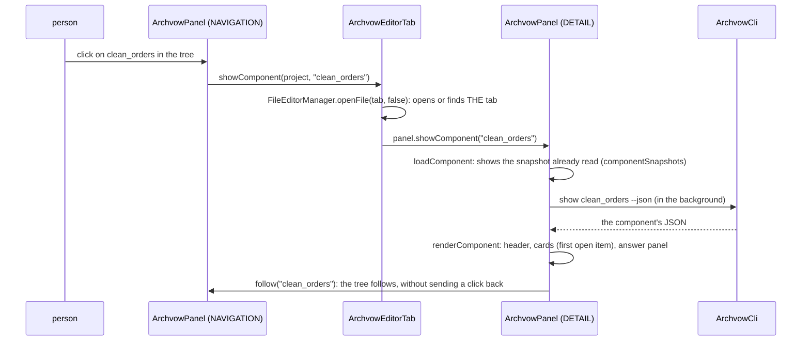
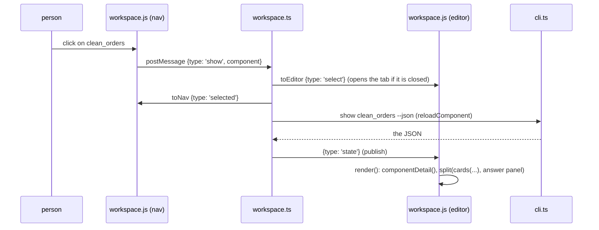

# 1. Reading guide

> 🇫🇷 [Version française](/01-reading-guide) · English version

## Preparing a working copy

```bash
git clone <archvow-plugin repository> && cd archvow-plugin
python3 -m pip install archvow==2.1.0        # the CLI the plugins are tested with (archvow version)

# IntelliJ: a JDK 21 (IntelliJ's own works)
export JAVA_HOME="/Applications/IntelliJ IDEA.app/Contents/jbr/Contents/Home"
(cd intellij && ./gradlew check)              # coreTest + workspaceTest, no IDE
(cd intellij && ./gradlew runIde)             # a sandbox IntelliJ with the plugin

# VS Code: Node 20 or later
(cd vscode && npm ci && npm test)             # compile + 55 tests
# then open vscode/ in VS Code and press F5: an "Extension Development Host" window

./build.sh                                    # both, after their tests -> dist/
```

`./gradlew` downloads the IntelliJ platform (2024.3.5) from the JetBrains repositories the first time.
Without access to them, the page [Tests](/en/13-tests) explains how to compile and test the code
against stand-ins of the platform classes.

## What to know before reading

| Topic | Where the plugins use it | Worth knowing |
|---|---|---|
| Swing | all of `org.archvow.idea` | no UI framework on top: `JPanel`, `CardLayout`, `JList` with a custom renderer, `JEditorPane` in HTML 3.2 |
| The IntelliJ platform | `plugin.xml`, `ArchvowToolWindowFactory`, `ArchvowEditorProvider`, `org.archvow.vow` | a tool window, a file editor for the tab, a language (lexer, parser, annotator) |
| The VS Code API | `vscode/src/extension.ts`, `vscode/src/workspace.ts`, `vscode/src/vowLanguage.ts` | a *webview view* (sidebar), a *webview panel* (the tab), language providers |
| The web page | `vscode/media/workspace.js`, `vscode/media/workspace.css` | plain JavaScript, no framework, nothing loaded from outside; the page runs nothing, it asks |
| The archvow CLI | page [Running archvow](/en/05-running-archvow) | always `archvow <command> --json` read from stdout; stderr kept apart |
| The .vow format | page [The .vow language](/en/10-vow-language) | two spaces per level, one `key value` line, blocks; no keyword list |

## Following a click through the code

The fastest way in: follow a click on a component of the tree once, with the files open.

**IntelliJ** (`ArchvowPanel` in its two roles):



**VS Code** (the same web page in two roles, the extension between them):



Then do the same for **Save answer** (page [A component](/en/08-component)) and for a command form
(page [Commands](/en/09-commands)). After these three, the rest is a variation.

## Where to start in a big file

`ArchvowPanel.java` is 4,000 lines long (splitting it is in `docs/analyse-intellij.md`). Read it by
sections, in this order: the constructor (the two roles), `buildHeader`, `overviewPanel`,
`componentPanel` (a component's views), `renderComponent`, then the actions (`submitInlineDecision`,
`openCommand`, `executeDirect`). `vscode/media/workspace.js` follows the same order: `page()`,
`overviewTab()`, `componentDetail()`, the views (`decisionsView`...), then `actions`.
