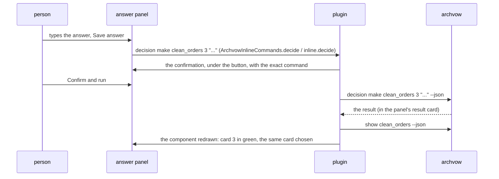

# 8. A component

> 🇫🇷 [Version française](/08-component) · English version

This is the screen where most time is spent: a component in the tab, its open items, and the answer
next to them. Everything it shows comes from `archvow show <component> --json` (and from its entry in
`show --json` for the module and the ticket).

## The layout

```
┌───────────────────────────────────────────────────────────────────────────┐
│ ← sales_reader (Back, when there is one)   ARCHVOW · COMPONENT            │
│ clean_sales  3 open items                                                  │  header, full width
│ transformation · p1_domain · module ... · ticket FATTRIB-12 · verified     │
│ Keep the rows where amount > 0 ...                                         │
│ Uses: sales_schema · Used by: revenue_writer    Examples: ✓ ...            │
│ [Clarify] Open spec  Open code  Edit spec  ...                             │  actions
│ (Decisions · 1) (Questions) (Safety ✓) (Assumptions) (Rules) (Tasks) ...   │  views
├──────────────────────────────────┬────────────────────────────────────────┤
│ 1 · Which rows does it keep…     │ ANSWER DECISION 3                      │
│     amount > 0                   │ Missing header: infer or fail?         │
│     kaneusb@... · 2026-10-25     │ ┌────────────────────────────────────┐ │
│ 3 · Missing header…              │ │ (field, monospaced font)           │ │
│     ● Open                       │ └────────────────────────────────────┘ │
│                                  │ Propose      Undo changes  [Save]      │
└──────────────────────────────────┴────────────────────────────────────────┘
       the cards                           the answer panel
```

**The header**: the name and the number of open items (the same as the sidebar), then *type · layer ·
module · ticket · state*, **one progress bar** (decisions made, safety answered, tasks done, examples
tested - each only when there is something to count -, green when complete, amber otherwise, the counts
in the tooltip: `ArchvowProgress`, `progress()` and `progressBar()`), the description, **Drawn from**
the brief it comes from (show `source`; a link that opens the brief at its heading: `ArchvowBriefs.drawnFromHtml`,
`drawnFrom()`), *Uses · Used by* (each name opens that component: what a
change may break, `ArchvowLinks`, `links()`) and the business examples (✓ tested and unchanged, ✖ with
the reason, ARCH055/ARCH056). IntelliJ: `buildComponentHtml` in the `componentDetails` panel;
VS Code: `componentDetail()`, `openBadge()`, `meta()`.

**The actions**: Clarify (goes to the first open item: decision, then question, then safety question;
`guidedNext`, `chooseNext()`), Open spec, Open code (the `module`'s file), Edit spec, AI instruction
(`archvow prompt <component>`), + Question, + Rule, + Component.

**The views**: Decisions, Questions, Safety, Assumptions, Rules, Tasks, Full vow, Other / Project.
Each button says `· n` pending items, or ✓ when everything is resolved (`refreshViewStatus`,
`viewCounts()`). Under the views, a line explains why the component's total may exceed the view
("9 pending · 0 in Data & tasks · 4 in Other / Project").

## The cards and the answer panel

For Decisions, Questions, Safety and Assumptions, the view is split in two (IntelliJ:
`ArchvowSplitView`; VS Code: `split()` and the `.split` grid):

- **on the left, the items as cards** (`ArchvowItemCards`, `cards()`): "3 · the question" on one line,
  then the recorded answer in green with who and when, or "● Open" in orange; one line each, cut with
  "…", the whole text in the tooltip and on the right;
- **on the right, the answer panel** of the chosen card: its title ("ANSWER DECISION 3",
  "DECISION 1 · RESOLVED"), the whole question, the AI's proposal or the suggestion, the field, the
  other actions on the left, **Undo changes / Save answer** on the right, then the confirmation. "Undo
  changes" ("Cancel" up to 0.12, whose purpose was not obvious) is enabled only when the field differs from
  the recorded text, and only puts it back: nothing is saved or removed (`cancelButton`, `recorded`;
  VS Code: `answerEditor`, `undoTip`).
- Under 680 px (IntelliJ) or 760 px (VS Code): the panel goes under the cards.
- A view with no item shows "Nothing to display.", with no answer panel.

**When a component opens, each view is on its first open item** (otherwise the first one): the answer
panel is ready. The same component redrawn (after an answer, a reread) keeps the chosen card. IntelliJ:
`fill()` and `renderedComponent` in `renderComponent`, `ArchvowItemCards.firstOpen`; VS Code:
`current()` (the chosen card, otherwise the first open one) and `selectComponent()`, which resets the
choices when the component changes.

| View | Field | Actions | Command run |
|---|---|---|---|
| Decisions | the answer or the proposal | Save answer, Propose, Accept proposal, Use suggestion (only those that apply) | `decision make`, `decision propose`, `decision accept` |
| Questions | the answer | Save answer | `decision make <c> <key>` |
| Safety | the hazard, or why it does not apply; the severity; or the invariant it needs | Declare hazard, Not applicable, Use the suggested hazard (and invariant); on a recorded hazard: Change, Remove; Add invariant (in place), Add invariant…, Remove invariant… | `hazard add`, `hazard dismiss`, `hazard remove` (+ `hazard add` for Change), `invariant add`; forms `invariant add`, `invariant remove` |
| Assumptions | - | Accept, Reject (forms), + Assumption | `assumption accept`, `assumption reject`, `assumption add` |

One field, three uses (0.13.1): declare the hazard of an open question; change a recorded hazard
(Change: the field takes its text and severity, saving runs `hazard remove` then `hazard add`, confirmed
once - only while no invariant protects it, archvow 1.18 having no `hazard edit`); write the invariant a
high or critical hazard needs (ARCH030), right there, filled with the template's suggestion - archvow
gives it only while the question is open, so both plugins keep it (`rememberedInvariants`,
`ui.suggested`). "Add required invariant" in the Pending lists opens this field, no longer the form. A
question resolved and protected shows only its hazards, its invariants and the removals. Its state
follows archvow's rules: `ArchvowSafetyState`, the `safety` object of `vscode/src/workItems.ts`.
IntelliJ lays the buttons out in an `ArchvowWrapLayout` (a `FlowLayout` that asks for the height of
every row: "Remove hazard…" fell outside the panel).

"hazard" and "invariant" are keywords: French keeps them ("Déclarer un hazard").

## Saving an answer, end to end



IntelliJ: `submitInlineDecision` -> `requestConfirmation` (an `ArchvowConfirmPanel` in the
`decisionConfirmSlot`) -> `runInlineComponentAction`. VS Code: the page sends `inline`,
`ArchvowProject.inlineAction` builds the command, `confirm` sends a token, the page answers
`confirmed`, then `execute` and `reloadComponent`. Changing card, view or component cancels a
confirmation left open: you never confirm an action prepared for something else.

## The other views

| View | What it shows | Actions |
|---|---|---|
| Rules | the rules that apply to the component (R1, R2...) and their scope | Add, Edit, Remove a rule (forms) |
| Tasks | the columns to classify and the card's tasks; personal data | Classify column (`column set`), a task's instructions (`prompt <c> --task n`, `ArchvowTaskPrompt`, `promptCommand()`) |
| Full vow | the component's `spec.vow`, highlighted, read-only | Open spec |
| Other / Project | the checks and items of the whole project, or without a proven component | each item's action; a fix is drawn from a message only when it is documented (`ArchvowIssueAction`, `issueFix()`), never run as it is |
