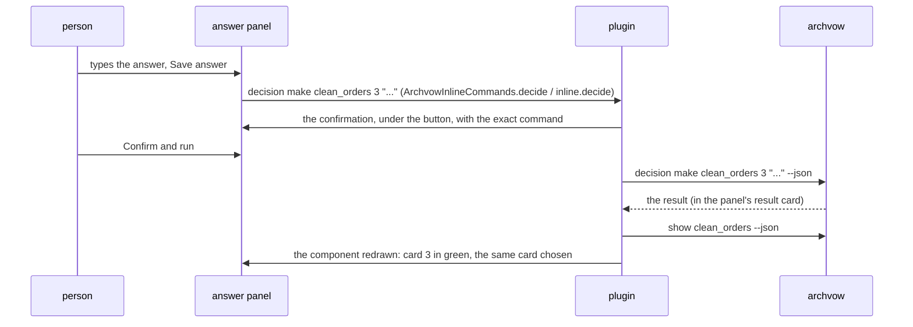

# 8. A component

> 🇫🇷 [Version française](/08-component) · English version

This is the screen where most time is spent: a component in the tab, its open items, and the answer
next to them. Everything it shows comes from `archvow show <component> --json` (and from its entry in
`show --json` for the module and the ticket).

## The layout

```
┌───────────────────────────────────────────────────────────────────────────┐
│ ← sales_reader (Back, when there is one)   ARCHVOW · COMPONENT            │
│ clean_sales  3 open items                                                  │  header, full width
│ transformation · p1_domain · module ... · ticket FATTRIB-12 · verified     │
│ Keep the rows where amount > 0 ...                                         │
│ Uses: sales_schema · Used by: revenue_writer    Examples: ✓ ...            │
│ [Clarify] Open code  Edit spec  ...                                        │  actions
│ (Decisions · 1) (Questions) (Safety ✓) (Assumptions) (Rules) (Tasks) ...   │  views
├──────────────────────────────────┬────────────────────────────────────────┤
│ 1 · Which rows does it keep…     │ ANSWER DECISION 3                      │
│     amount > 0                   │ Missing header: infer or fail?         │
│     kaneusb@... · 2026-10-25     │ ┌────────────────────────────────────┐ │
│ 3 · Missing header…              │ │ (field, monospaced font)           │ │
│     ● Open                       │ └────────────────────────────────────┘ │
│                                  │ Propose      Undo changes  [Save]      │
└──────────────────────────────────┴────────────────────────────────────────┘
       the cards                           the answer panel
```

**The header**: the name and the number of open items (the same as the sidebar), then *type · layer ·
module · ticket · state*, **one progress bar** (decisions made, safety answered, tasks done, examples
tested - each only when there is something to count -, green when complete, amber otherwise, the counts
in the tooltip: `ArchvowProgress`, `progress()` and `progressBar()`), the description, **Drawn from**
the brief it comes from (show `source`; a link that opens the brief at its heading: `ArchvowBriefs.drawnFromHtml`,
`drawnFrom()`), *Uses · Used by* (each name opens that component: what a
change may break, `ArchvowLinks`, `links()`) and the business examples (✓ tested and unchanged, ✖ with
the reason, ARCH055/ARCH056). IntelliJ: `buildComponentHtml` in the `componentDetails` panel;
VS Code: `componentDetail()`, `openBadge()`, `meta()`.

**The actions**: Clarify (goes to the first open item: decision, then question, then safety question;
`guidedNext`, `chooseNext()`), Open code (the `module`'s file), Edit spec, AI instruction
(`archvow prompt <component>`), + Question, + Rule, + Component; Accept… for a component the AI created
(archvow 1.19, modes guided and free: its vow says `origin ai`, `created_by`), which shows **AI: to
review** in the tree and its head until a person runs `component accept` (`aiBadge()`, `createdByAi()`,
`buildComponentHtml`, `aiAcceptButton`).

**The views**: Decisions, Questions, Safety, Assumptions, Rules, Tasks, Spec, Other / Project.
Each button says `· n` pending items, or ✓ when everything is resolved (`refreshViewStatus`,
`viewCounts()`). Under the views, a line explains why the component's total may exceed the view
("9 pending · 0 in Data & tasks · 4 in Other / Project").

## The cards and the answer panel

For Decisions, Questions, Safety and Assumptions, the view is split in two (IntelliJ:
`ArchvowSplitView`; VS Code: `split()` and the `.split` grid):

- **on the left, the items as cards** (`ArchvowItemCards`, `cards()`): "3 · the question" on one line,
  then the recorded answer in green with who and when, or "● Open" in orange; one line each, cut with
  "…", the whole text in the tooltip and on the right;
- **on the right, the answer panel** of the chosen card: its title ("ANSWER DECISION 3",
  "DECISION 1 · RESOLVED"), the whole question, the AI's proposal or the suggestion, the field, the
  other actions on the left, **Undo changes / Save answer** on the right, then the confirmation. "Undo
  changes" ("Cancel" up to 0.12, whose purpose was not obvious) is enabled only when the field differs from
  the recorded text, and only puts it back: nothing is saved or removed (`cancelButton`, `recorded`;
  VS Code: `answerEditor`, `undoTip`).
- Under 680 px (IntelliJ) or 760 px (VS Code): the panel goes under the cards.
- A view with no item shows "Nothing to display.", with no answer panel.

**When a component opens, each view is on its first open item** (otherwise the first one): the answer
panel is ready. The same component redrawn (after an answer, a reread) keeps the chosen card. IntelliJ:
`fill()` and `renderedComponent` in `renderComponent`, `ArchvowItemCards.firstOpen`; VS Code:
`current()` (the chosen card, otherwise the first open one) and `selectComponent()`, which resets the
choices when the component changes.

| View | Field | Actions | Command run |
|---|---|---|---|
| Decisions | the answer or the proposal | Save answer, Propose, Accept proposal, Use suggestion (only those that apply) | `decision make`, `decision propose`, `decision accept` |
| Questions | the answer | Save answer | `decision make <c> <key>` |
| Safety | the hazard, or why it does not apply; the severity; or the invariant it needs | Declare hazard, Not applicable, Use the suggested hazard (and invariant), Confirm (covered by a decision), Confirm not applicable; on a recorded hazard: Change, Remove; Add invariant (in place), Add invariant…, Remove invariant… | `hazard add`, `hazard dismiss` (no reason when the decision is the reason), `hazard edit` (Change), `hazard remove`, `invariant add`; forms `invariant add`, `invariant remove` |
| Assumptions | - | Accept, Reject (forms), + Assumption | `assumption accept`, `assumption reject`, `assumption add` |

One field, three uses (0.13.1): declare the hazard of an open question; change a recorded hazard
(Change: the field takes its text and severity, saving runs `hazard edit` - 0.14.0, archvow 1.19: same
id, its invariants stay and become to review; offered for every recorded hazard); write the invariant a
high or critical hazard needs (ARCH030), right there, filled with the template's suggestion - archvow
gives it only while the question is open, so both plugins keep it (`rememberedInvariants`,
`ui.suggested`). "Add required invariant" in the Pending lists opens this field, no longer the form. A
question resolved and protected shows only its hazards, its invariants and the removals.

**A question a decision already answers** (archvow 1.19: `show --json` gives the suggestion's `decision`
{number, answer}): "Covered by decision N", its answer, and **Confirm** - `hazard add` without words, so
archvow records the hazard and an invariant that *is* that decision (`from_decision`). When the decision
says there is nothing to protect (`not_applicable`), **Confirm not applicable** sends `hazard dismiss` with no
reason: the decision is the reason. The proposed invariant and "Use the suggested hazard" are not shown
then (`ArchvowSafetyState.coveringDecision` / `notApplicable`).

**Decisions without a safe default** (archvow 1.19: a decision's `choices`) offer them as buttons under
"No default (it depends on this project) - to start from:"; one fills the answer field, to complete
(`useChoice`, `decisionChoices`). Its state
follows archvow's rules: `ArchvowSafetyState`, the `safety` object of `vscode/src/workItems.ts`.
IntelliJ lays the buttons out in an `ArchvowWrapLayout` (a `FlowLayout` that asks for the height of
every row: "Remove hazard…" fell outside the panel).

"hazard" and "invariant" are keywords: French keeps them ("Déclarer un hazard").

### Answer with a table (0.15.0)

Under a decision about columns (nullable, personal data, type), an optional table: one row per known column,
Never null / Nullable / Unknown and Yes / No / Unknown as buttons, notes, and a bin on every row (IntelliJ had
none); only what the question asks about is shown (a personal-data question has no Nullable column). Under a
`name: type = default` question (config, settings), the parameters table (`smartParameters()`,
`ArchvowColumnAnswerPanel` in `PARAMETERS` mode): parameter, type, default (empty = required), notes; it reads
back an answer written that way, not a sentence. Nothing is saved: **Use this answer** fills the field, to read
before saving.

## Where an item came from, and what the AI added (0.16.0)

No tab of its own: what the AI added sits in Decisions, Safety and Rules, marked. `aiView()` (VS Code,
`vscode/src/aiSkills.ts`, computed by the extension for each component as `state.ai`) and
`ArchvowAiSkills.view` (IntelliJ) read archvow 1.20's `show --json` and give each decision, hazard and rule an
**origin**: `ai` (`added_by`, or an answer the AI proposed), `project` (`origin: type`), `brief` (`source`),
`template` (a template question, a suggested hazard) - or nothing, a person's own. One tag per card
(`originTag()`, `ArchvowItemCards.tag`); `to_accept` makes it **To review** (a blue outline). The views count
them (a blue dot on the view, "N from AI to review" next to the name), **All / Open / To review** filters the
cards (IntelliJ finds the row of a filtered card by its number: `selectedRecord`). In the answer panels: **Why
the AI asked**; an AI question has **Keep, answer later** (`question accept`) and **Remove question**, Save answer
keeps it too; an AI hazard **Keep** (`hazard accept`); an AI rule **Keep** / **Remove** (`rule accept`, `rule
remove`).

**Suggested next with AI** (`suggestStrip()`, `refreshSuggestion`): one suggestion, with why - what the AI added
first, then Find missing questions (until a person started it here: the skills started are kept per component,
workspace state / `PropertiesComponent`), the decisions (no suggestion: a person's turn), Find risks, Implement,
Review changes. **AI skills ▾** (`aiMenu()`, `showAiMenu`) lists the five, the suggested one marked, a skill that
cannot run yet disabled with why (`blocked`).

## A calmer tab (0.17.0)

**Four quiet actions**: **Open code**, **Edit spec**, **+ Add ▾** (`addMenu()`, `showAddMenu`: a question, a
rule, an assumption - what a person adds to this component; a new component is added from the Components tab)
and **✦ AI ▾** (`aiMenu()`, `showAiMenu`: the five skills, then **Copy the card for another AI**, `archvow
prompt`). The only filled button is the suggested step of the strip (and Accept on a component the AI created).
Clarify is no button any more: the first open item is already selected, and after Save answer the next open one
of the view shows (`ui.advance` / `current()`, `advance` / `fill(..., saved)` and `ArchvowItemCards.nextOpenAfter`).

**The line under the views** (`listFilter()`, `refreshListFilter` and `ArchvowListFilter`): "Show **All** · Open
2 · To review 1", words, not buttons; To review only when the AI added something, no Open in Rules; a view with
nothing open left says where the work is ("Decisions: all done · Safety: 2 open ›"). In the answer panel, one
button (Save answer, **▾ › Save as a proposal**); Use the suggestion, Accept the AI's proposal, Keep, answer
later, Remove question and Undo are links (`button.link`, `ArchvowSplitView.link`).

The menus (✦ AI ▾, + Add ▾, Save ▾) are `ArchvowMenu` rows in IntelliJ (0.17.1): a heading, a line between the groups, the row under the mouse highlighted, a step that cannot run yet greyed with why, the suggested one tinted. The strip's button keeps its size and goes under the text when the strip is narrower than 720 px (`STRIP_SIDE_BY_SIDE`).

Since 0.17.2, no "Suggested next" strip: the actions are, in this order, **✦ AI ▾** (**✦ AI spec ▾** in IntelliJ since 0.17.3; the one filled button; its menu marks the suggested step), **+ Add ▾**, **Edit spec**, **Open code**; **Save as a proposal** is a real button beside Save answer.

## Saving an answer, end to end



IntelliJ: `submitInlineDecision` -> `requestConfirmation` (an `ArchvowConfirmPanel` in the
`decisionConfirmSlot`) -> `runInlineComponentAction`. VS Code: the page sends `inline`,
`ArchvowProject.inlineAction` builds the command, `confirm` sends a token, the page answers
`confirmed`, then `execute` and `reloadComponent`. Changing card, view or component cancels a
confirmation left open: you never confirm an action prepared for something else.

## The other views

| View | What it shows | Actions |
|---|---|---|
| Rules | the rules that apply to the component (R1, R2...) and their scope | Add, Edit, Remove a rule (forms) |
| Tasks | the columns to classify and the card's tasks; personal data | Classify column (`column set`), a task's instructions (`prompt <c> --task n`, `ArchvowTaskPrompt`, `promptCommand()`) |
| Spec | the card the AI implements (`spec.md`) or the vow it is written from (`spec.vow`, highlighted), a switch between them, read only (0.14.0: one view instead of Open spec and Full vow; `vowView()`, `specPanel()`) | Open in the editor, Project vow |
| Other / Project | the checks and items of the whole project, or without a proven component | each item's action; a fix is drawn from a message only when it is documented (`ArchvowIssueAction`, `issueFix()`), never run as it is |
