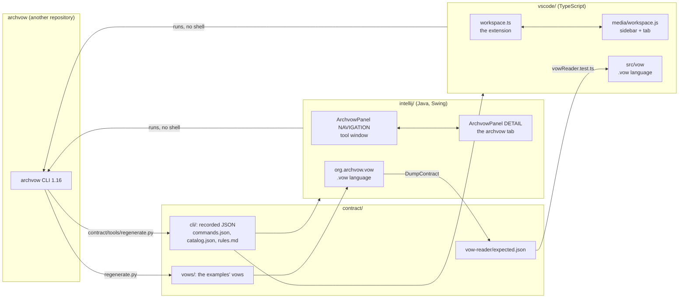

# archvow-plugin - the code, from zero to 100 %

> 🇫🇷 [Version française](/home) · English version (the French version is the default)

archvow-plugin is archvow's two IDE plugins, in one repository: the **IntelliJ** plugin (IntelliJ IDEA,
PyCharm and the other JetBrains IDEs) and the **VS Code** extension. They show what archvow knows about
a project (its components, their decisions, their questions, their safety, the checks) and run the
archvow commands that change it. They do not replace archvow: **the CLI stays the only writer of the
spec**.

This wiki is for **the people who maintain the plugins**. It explains how they are built: every file,
every flow, and why. The user documentation is in the READMEs (`README.md`, `intellij/README.md`,
`vscode/README.md`); this wiki does not repeat it, it explains the code behind it. archvow's own wiki
(`wiki/` of the archvow repository) explains the CLI itself: read it to learn what a decision, a hazard
or `archvow check` is.

Version described: **archvow-plugin 0.11.4**, for **archvow 1.16** (`contract/cli/version.txt`).
About 11,700 lines of Java (`intellij/src/main/java`), 5,300 lines of TypeScript, JavaScript and CSS
(`vscode/src`, `vscode/media`), 34 IntelliJ test classes and 55 VS Code tests.

The wiki lives in the repository, folder `wiki/` (French at the root, English in `wiki/en/`): it
changes in the same commit as the code, and a test fails `npm test` when it no longer follows the code
(page [Tests](/en/13-tests)).

## How to read this wiki

Read the pages in order the first time; each builds on the previous ones. Each page names the files and
classes it explains: open them alongside.

| # | Page | What you will understand |
|---|---|---|
| 1 | [Reading guide](/en/01-reading-guide) | how to build, test, and follow a click through the code |
| 2 | [Big picture](/en/02-big-picture) | the rules both plugins share, the map of the files |
| 3 | [Repository layout](/en/03-repository-layout) | every folder and file |
| 4 | [The contract](/en/04-contract) | what the plugins and the CLI share, and how to regenerate it |
| 5 | [Running archvow](/en/05-running-archvow) | no shell, one command at a time, the IDE's interpreter, WSL |
| 6 | [The sidebar and the tab](/en/06-sidebar-and-tab) | the screen's two roles, the single tab, Back |
| 7 | [Overview](/en/07-overview) | the project's state, the architecture, Check & Gates, the results |
| 8 | [A component](/en/08-component) | the header, the views, the cards and the answer panel |
| 9 | [Commands](/en/09-commands) | forms drawn from the CLI, prefill, confirmations |
| 10 | [The .vow language](/en/10-vow-language) | the reader, highlighting, links, in both IDEs |
| 11 | [Problems and checks](/en/11-problems-and-checks) | `archvow check` in the editor |
| 12 | [Languages and look](/en/12-languages-and-look) | English / French, colours, text sizes, narrow screens |
| 13 | [Tests](/en/13-tests) | what is tested, how, without an IDE |
| 14 | [Releasing](/en/14-release) | the numbers to change, the patches, a new archvow version |
| 15 | [Recipes](/en/15-recipes) | adding an action, a setting, a translation... |
| 16 | [Design decisions and limits](/en/16-design-decisions) | why it is built this way, what it does not do |
| 17 | [Glossary](/en/17-glossary) | every term in one place |

## The whole repository on one page

Both plugins **read what the CLI prints** (`show --json`, `next --json`, `check --json`) and **run an
archvow command, after a confirmation, for every change**. Everything in the repository serves one of
these two halves, or the contract that guarantees they understand the same CLI.
