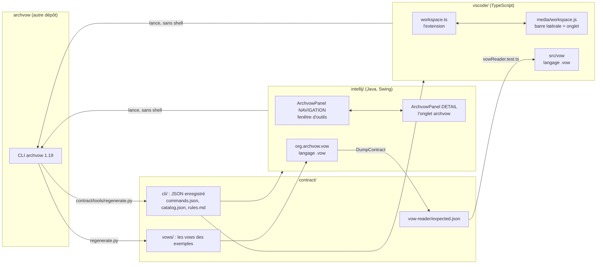

# archvow-plugin - le code, de zéro à 100 %

> 🇬🇧 [English version](/en/home) · Version française (par défaut)

archvow-plugin, ce sont les deux plugins d'IDE d'archvow, dans un seul dépôt : le plugin **IntelliJ**
(IntelliJ IDEA, PyCharm et les autres IDE JetBrains) et l'extension **VS Code**. Ils montrent ce
qu'archvow sait d'un projet (ses composants, leurs décisions, leurs questions, leur sûreté, les
contrôles) et lancent les commandes archvow qui le changent. Ils ne remplacent pas archvow : **la CLI
reste le seul à écrire la spec**.

Ce wiki s'adresse à **ceux qui maintiennent les plugins**. Il explique comment ils sont construits :
chaque fichier, chaque flux, et pourquoi. La documentation pour les utilisateurs est dans les README
(`README.md`, `intellij/README.md`, `vscode/README.md`) ; ce wiki ne la répète pas, il explique le
code qui est derrière. Celui d'archvow (`wiki/` du dépôt archvow) explique la CLI elle-même : lisez-le
pour savoir ce qu'est une décision, un danger ou `archvow check`.

Version décrite : **archvow-plugin 0.15.0**, pour **archvow 1.19** (`contract/cli/version.txt`).
Environ 11 700 lignes de Java (`intellij/src/main/java`), 5 300 lignes de TypeScript, JavaScript et CSS
(`vscode/src`, `vscode/media`), 34 classes de tests IntelliJ et 55 tests VS Code.

Le wiki vit dans le dépôt, dossier `wiki/` (français à la racine, anglais dans `wiki/en/`) : il
change dans le même commit que le code, et un test fait échouer `npm test` quand il ne suit plus le
code (page [Les tests](/13-tests)).

## Comment lire ce wiki

Lisez les pages dans l'ordre la première fois ; chacune s'appuie sur les précédentes. Chaque page
nomme les fichiers et les classes qu'elle explique : ouvrez-les à côté.

| # | Page | Ce que vous comprendrez |
|---|---|---|
| 1 | [Guide de lecture](/01-reading-guide) | comment construire, tester, et suivre un clic dans le code |
| 2 | [Vue d'ensemble](/02-big-picture) | les règles communes aux deux plugins, la carte des fichiers |
| 3 | [Organisation du dépôt](/03-repository-layout) | chaque dossier et fichier |
| 4 | [Le contrat](/04-contract) | ce que les plugins et la CLI ont en commun, et comment le régénérer |
| 5 | [Lancer archvow](/05-running-archvow) | sans shell, une commande à la fois, l'interpréteur de l'IDE, WSL |
| 6 | [La barre latérale et l'onglet](/06-sidebar-and-tab) | les deux rôles de l'écran, l'onglet unique, Retour |
| 7 | [Vue d'ensemble (Overview)](/07-overview) | l'état du projet, l'architecture, Check & Gates, les résultats |
| 8 | [Un composant](/08-component) | l'en-tête, les vues, les cartes et le panneau de réponse |
| 9 | [Les commandes](/09-commands) | les formulaires tirés de la CLI, le pré-remplissage, les confirmations |
| 10 | [Le langage .vow](/10-vow-language) | le lecteur, la coloration, les liens, dans les deux IDE |
| 11 | [Problèmes et contrôles](/11-problems-and-checks) | `archvow check` dans l'éditeur |
| 12 | [Langues et apparence](/12-languages-and-look) | anglais / français, couleurs, tailles de texte, écrans étroits |
| 13 | [Les tests](/13-tests) | ce qui est testé, comment, sans IDE |
| 14 | [Publier une version](/14-release) | les numéros à changer, les patches, une nouvelle version d'archvow |
| 15 | [Recettes](/15-recipes) | ajouter une action, un réglage, une traduction... |
| 16 | [Choix de conception et limites](/16-design-decisions) | pourquoi c'est construit ainsi, ce que ça ne fait pas |
| 17 | [Glossaire](/17-glossary) | chaque terme au même endroit |

## Tout le dépôt sur une page

Les deux plugins **lisent ce que la CLI affiche** (`show --json`, `next --json`, `check --json`) et
**lancent une commande archvow, après une confirmation, pour chaque changement**. Tout dans le dépôt
sert l'une de ces deux moitiés, ou le contrat qui garantit qu'elles comprennent la même CLI.
